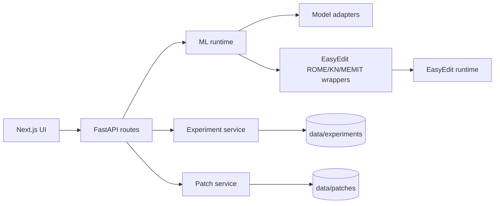

# Architecture

The workbench is a local-first monorepo with a FastAPI backend and Next.js frontend.

## Backend

- `app/api`: HTTP route modules.
- `app/services`: model registry, experiment logging, patch persistence, evaluation orchestration.
- `app/ml`: adapters, generation, logit lens, tracing, editing wrappers, metrics.
- `app/storage`: local JSON store used by the current MVP.
- `app/workers`: Celery entry point for moving synchronous editing/tracing jobs into background workers.

## Frontend

- `src/app`: route pages for workbench, generation, logit lens, tracing, editing, and evaluation.
- `src/components`: reusable tool panels.
- `src/lib`: API client and shared types.

## Runtime

Install `backend[ml]`, clone EasyEdit, install EasyEdit's requirements, and set `EASYEDIT_ROOT` to run model-backed generation, logit lens, tracing, and editing through Hugging Face Transformers and EasyEdit.

ROME, KN, and MEMIT use EasyEdit through `easyedit_runtime.py`. The runtime:

- resolves compatible hparams from `EASYEDIT_ROOT`, such as `hparams/ROME/gpt2-xl.yaml`;
- constructs method-specific hyperparams and `BaseEditor`;
- lets ROME requests auto-locate a layer with causal tracing when no layer override is supplied;
- calls `editor.edit(...)` with prompts, ground truth, targets, and optional evaluation inputs;
- saves EasyEdit metrics;
- extracts changed-weight deltas from EasyEdit's returned original weights and persists them as safetensors when available.
- captures KN's changed MLP-neuron vectors as sparse safetensors, so they can be replayed and reverted without retaining full MLP matrices.
